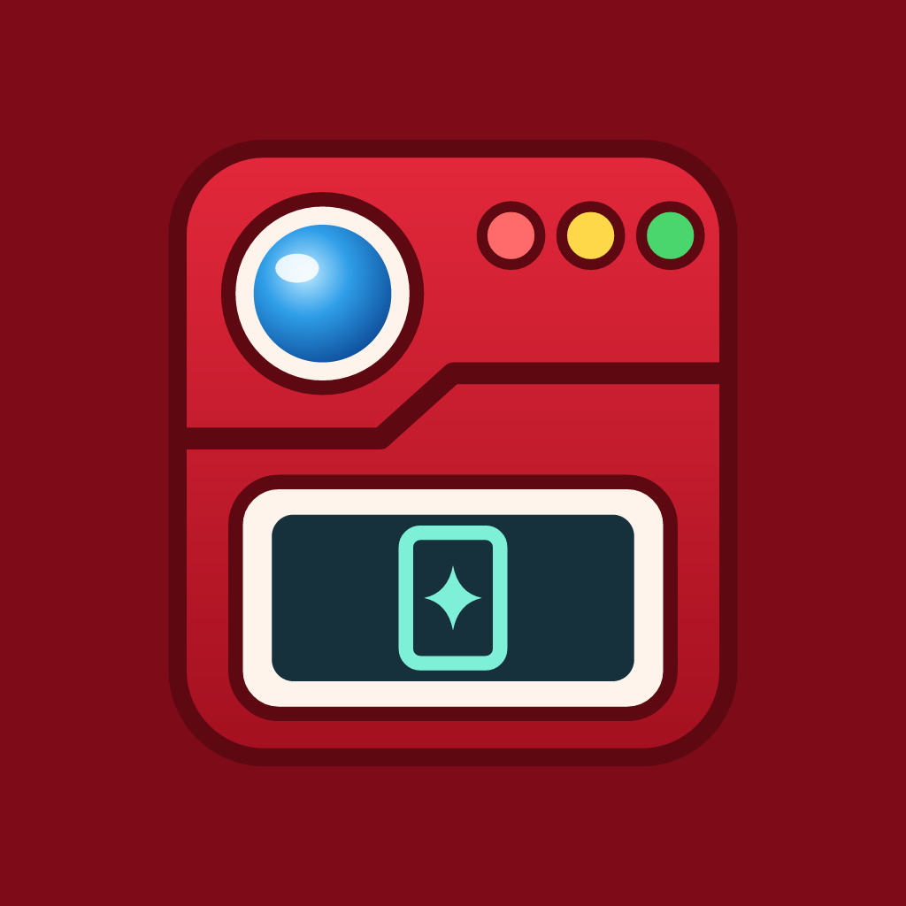
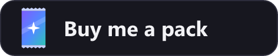
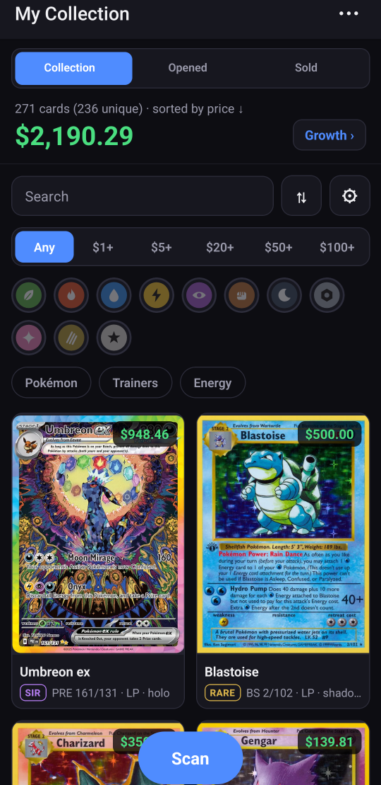
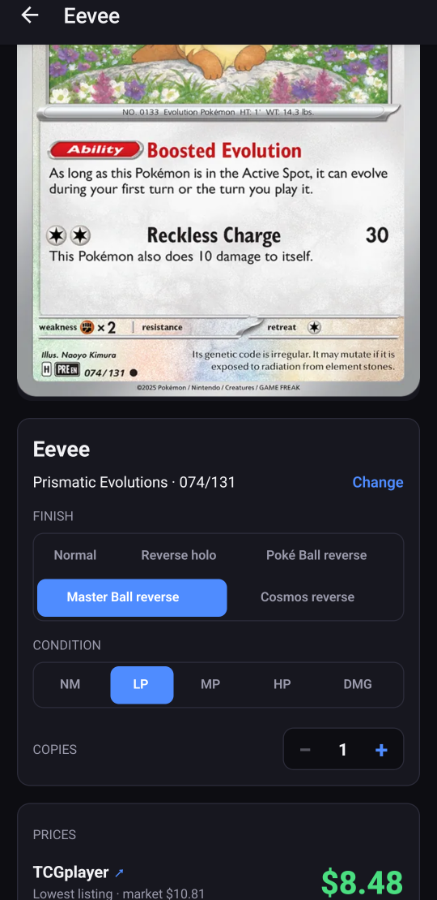
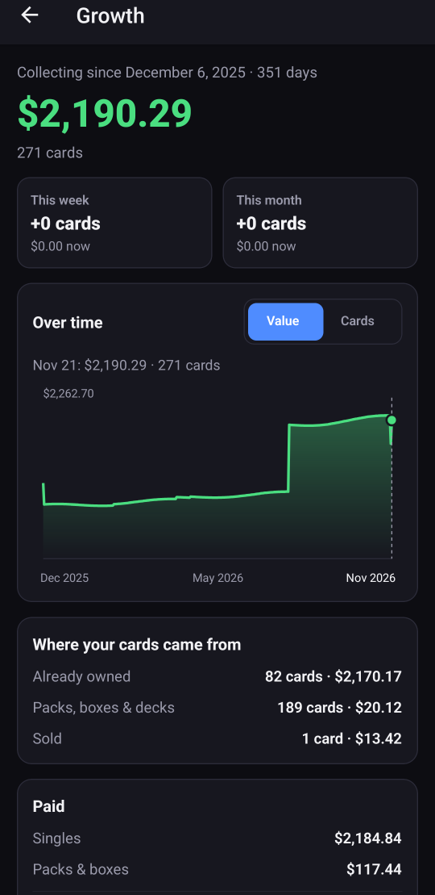
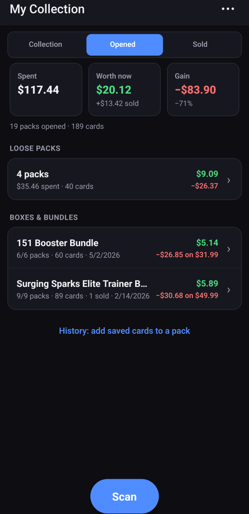
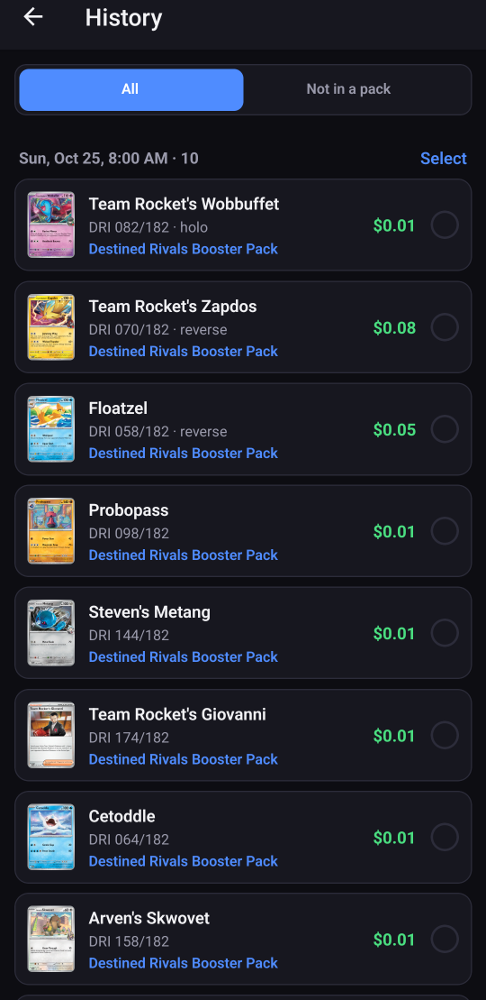

  

<h1 align="center">Living Dex</h1>

Scan your Pokémon cards. See what they're worth.

  <a href="https://github.com/bmead92/living-dex/releases/latest"><b>Download for Android</b></a>

  

  
  
  

  
  

## Features

- Hold cards up to the camera; they're added automatically
- Exact printing, from Base Set to today: holo, reverse holo, 1st Edition, Shadowless, and condition
- TCGplayer market prices, with Cardmarket alongside; set your own price for any card
- Track booster packs, boxes and Elite Trainer Boxes: what you paid vs what you pulled
- Sell cards and see what you made on them
- Your collection's value over time, and everything you've paid
- Search, filters by type and rarity, export, and automatic backups to your Downloads folder

Free. No account, no ads, nothing collected. Your collection stays on your phone; the app only talks to
TCGdex (cards and prices), TCGCSV (Base Set Shadowless prices) and GitHub (update check).

## Install

1. Download the **.apk** file from the [latest release](https://github.com/bmead92/living-dex/releases/latest).
2. Open it and allow the install. Play Protect may warn that it doesn't know the app; install anyway.

Updates install over the old version and keep your cards. Android 8 or newer.

---

Living Dex is an unofficial fan app. It is not produced, endorsed, supported or affiliated with
Nintendo, Creatures, GAME FREAK or The Pokémon Company. Card names and images are trademarks and copyrights
of their owners. Card data, images and prices from TCGdex; Shadowless prices from TCGCSV. [MIT License](LICENSE).
